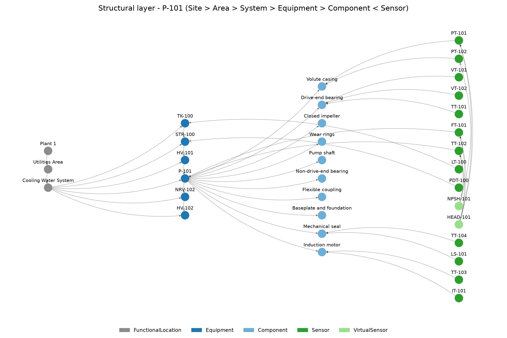
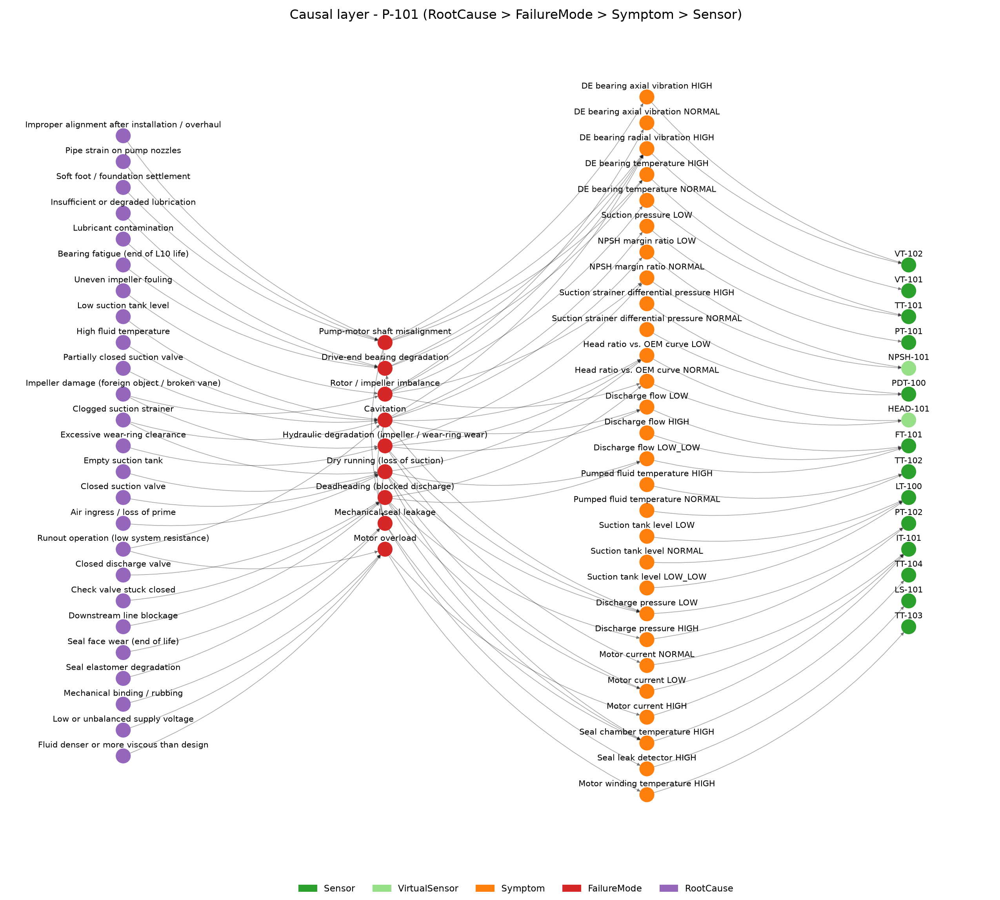

# Knowledge Layer for Centrifugal Pump Failures

**Author:** Pankaj Gurjar (Roll No. 24B0328) · DigiTwin Technology internship technical screening challenge

A programmatic **semantic-causal diagnostic network** for an industrial centrifugal pump (P-101, cooling-water
service), written in Python. It turns raw sensor readings into a root-cause diagnosis that you can trace step by step,
using an ontology, a NetworkX knowledge graph, first-principles pump physics and a rule-based inference engine. It also
produces grounded context for LLM-generated engineering reports.

```
 1. Physical assets            2. Causal logic                    3. Diagnosis
 (ontology layer)              (physics / failure paths)          (Python inference)
 Site > Area > System          RootCause --causes--> FailureMode  diagnose_fault(sensor_states)
 > Equipment > Component       FailureMode --manifests_as-->      -> ranked failure modes
 < Sensor --triggers--> Alarm  Symptom --observed_by--> Sensor    -> root causes + evidence + actions
```

## Quick start

```bash
pip install -r requirements.txt                 # only networkx is mandatory
python main.py                                  # build graph, export files, run all 13 scenarios
python main.py --scenario cavitation_hot_fluid  # one scenario, human-readable report
python main.py --scenario seal_leak --json      # raw JSON result
python main.py --scenario impeller_wear --llm   # grounded LLM prompt (Phase 4)
python main.py --readings "{\"flow\": 2, \"discharge_pressure\": 1.1, \"motor_current\": 13}"
python -m pytest -q                             # 24 tests (or: python -m unittest discover -s tests)
```

Use from Python:

```python
from diagnostic_engine import diagnose_fault, format_report

result = diagnose_fault({"suction_pressure": 0.45, "discharge_pressure": 4.92, "flow": 78,
                         "radial_vibration": 6.2, "strainer_dp": 0.55, "fluid_temperature": 30})
print(format_report(result))          # result itself is a JSON-serialisable dict
```

`sensor_states` accepts **numeric values or discrete states**, keyed by **signal name or instrument tag**:
`{"PT-101": "LOW", "seal_leak": True, "flow": 78.0}`.

## Project structure

| File | Phase | Purpose |
|---|---|---|
| `ontology.py` | 1 | Classes, parameters, relation types, **schema of allowed (domain, relation, range) triples** |
| `knowledge_base.py` | 1 | P-101 instance data: hierarchy, 10 components, 13 sensors + 2 virtual sensors, 9 failure modes, 25 root causes, 29 actions |
| `physics.py` | 1-3 | Vapour pressure (Antoine), water density, NPSHa / NPSH3, pump H-Q curve, developed head |
| `graph_builder.py` | 2 | Builds and validates the NetworkX graph; JSON / RDF-Turtle / PNG export; graph query helpers |
| `diagnostic_engine.py` | 3 | `diagnose_fault(sensor_states)` and `format_report()` |
| `llm_context.py` | 4 | GraphRAG: subgraph retrieval and grounded prompt builder |
| `scenarios.py` | - | 13 physically consistent test snapshots with expected answers |
| `main.py` | - | CLI demo; regenerates exports, figures, docs and per-scenario results |
| `reference_doc.py` | - | Generates `docs/KNOWLEDGE_BASE.md` from the graph |
| `tests/` | - | 24 unit and regression tests |
| `docs/LLM_Integration_Essay.md` | 4 | One-page essay: grounding LLMs with the causal graph |
| `docs/KNOWLEDGE_BASE.md` | 1 | Auto-generated data dictionary (every sensor, limit, signature, cause) |
| `docs/EXAMPLE_LLM_PROMPT.md` | 4 | A complete grounded LLM prompt for one scenario |
| `docs/figures/` | 2 | Structural and causal layer figures |
| `output/` | 2 | Graph exports `knowledge_graph.json` and `knowledge_graph.ttl` (per-scenario reports are generated here by `main.py`) |

## Why a centrifugal pump

It is the most common rotating asset in process plants. Its failure modes are well documented, and its physics is
well defined: NPSH, the H-Q curve, and the power-flow relation. That last point matters, because the engine can then
separate faults that look alike in raw data. Cavitation and impeller wear both reduce head, and deadheading and dry
running both stop the flow.

**Asset P-101:** 100 m³/h @ 50 m, shut-off head 60 m, NPSH3 4.0 m, 2950 rpm, 22 kW / 40 A motor, DN125 suction, 30 °C water.
Process line: `TK-100 → STR-100 → HV-101 → P-101 → NRV-102 → HV-102`.

---

## Phase 1: Ontology design

**Classes** (`NodeType`): `FunctionalLocation` (Site/Area/System), `Equipment`, `Component`, `Sensor`,
`VirtualSensor`, `Alarm`, `Symptom`, `FailureMode`, `RootCause`, `MaintenanceAction`.

**Key parameters per class**

| Class | Parameters |
|---|---|
| Equipment | class, nameplate (rated flow/head, shut-off head, NPSH3, speed, motor rating, pipe size, POR) |
| Component | class, design data (bearing type, seal flush plan, wear-ring clearance, insulation class) |
| Sensor | tag, signal key, measurand, unit, alarm limits LL/L/H/HH, normal value, monitored component |
| VirtualSensor | inputs (`derived_from`), formula, alarm limits |
| Alarm | state, limit, severity, message (generated from sensor limits) |
| FailureMode | severity, description, **physics mechanism**, weighted symptom signature with key symptoms |
| RootCause | description, evidence signature, location, prior likelihood |
| MaintenanceAction | type: IMMEDIATE / DIAGNOSTIC / CORRECTIVE |

**Relationships**: 15 typed relations, each with a declared domain and range. `validate_graph()` rejects any edge that
violates the schema (for example *Sensor causes FailureMode*). It also rejects cycles in the hierarchy or in fault
propagation, failure modes without a key symptom or root cause, and symptoms observed by more than one signal.

| Relation | From → To |
|---|---|
| `contains`, `has_component`, `feeds` | structural hierarchy and process flow |
| `monitors`, `derived_from`, `triggers` | instrumentation and alarms |
| `manifests_as` *(weighted)*, `observed_by` | failure mode → symptom → signal |
| `causes`, `evidenced_by` *(weighted)*, `located_in` | root cause → failure mode / evidence / asset |
| `propagates_to` | failure mode → failure mode (cascades, e.g. misalignment → bearing damage) |
| `occurs_in`, `mitigated_by`, `remedied_by` | location and actions |

**Logical asset paths** are computed from the hierarchy (ISA-95 style), for example
`Plant1/Utilities/CoolingWater/P-101/BRG-DE/TT-101`.

## Phase 2: Graph build

`build_graph()` creates one typed `networkx.DiGraph` (**162 nodes, 270 edges**) with two layers:

* **Structural:** functional locations → equipment → components ← sensors → alarms

  

* **Causal:** root causes → failure modes → symptoms → sensors / virtual sensors

  

Exports: `knowledge_graph.json` (a lossless round trip, which is tested), `knowledge_graph.ttl` (RDF/OWL Turtle with
classes, object properties with domain/range, instances and reified signature weights; it is parsed by rdflib in the
tests), and PNG figures drawn with barycentric crossing reduction.

## Phase 3: Diagnostic engine

`diagnose_fault(sensor_states)` contains **no pump-specific code**. It reads thresholds, signatures, causes and actions
from the graph, so a different asset only needs a new knowledge base.

1. **Normalise** inputs (key or tag, numeric or state). Unknown or unreadable inputs produce warnings, not crashes.
2. **Physics** virtual sensors:
   * `NPSH margin = NPSHa / NPSH3`, where `NPSHa = (p_s − p_v(T)) / ρg + v²/2g`. Vapour pressure comes from the Antoine
     equation (verified against steam tables in the tests).
   * `head ratio = H_measured / H_curve(Q)`, where `H_curve = H0 − kQ²` passes through shut-off and the duty point.
3. **Discretise** to LOW_LOW / LOW / NORMAL / HIGH / HIGH_HIGH and raise the matching **Alarm** nodes.
4. **Score each failure mode** against its symptom signature: MATCH `+w`, CONTRADICTS `−w`, ABSENT or UNKNOWN `0`;
   `confidence = clamp(Σ / Σw, 0, 1)`. If a **key symptom** is measured but absent, the hypothesis is **ruled out**.
5. **Propagation:** a failure mode is SECONDARY if an active upstream failure mode (`propagates_to`) is at least as
   certain. For example, bearing distress is explained by misalignment.
6. **Root-cause isolation:** the engine walks `causes` edges backwards and checks each cause's own evidence, which gives
   SUPPORTED / PARTIAL / UNVERIFIED / NOT_SUPPORTED / RULED_OUT.
7. **Explain:** evidence table, causal chains with node ids, and ordered actions (IMMEDIATE → DIAGNOSTIC → CORRECTIVE).

Output status: `FAULT_DETECTED`, `HEALTHY`, `ABNORMAL_UNEXPLAINED` (alarms present but no signature matches; the
engine does not force a guess), or `NOT_RUNNING` (motor current below the running threshold).

### Sound physics reasoning encoded in the signatures

| Failure mode | Signature (key symptoms in bold) | Physics |
|---|---|---|
| Cavitation | **NPSH margin LOW**, suction P LOW, radial vib HIGH, head ratio LOW | p at impeller eye → p_vapour, bubble collapse, head breakdown |
| Deadheading | **flow LL**, **discharge P HIGH**, **current LOW**, seal temp HIGH, head ratio NORMAL | Radial pump power is *minimum* at shut-off, so current falls; the energy heats the trapped liquid |
| Dry running | **flow LL**, **discharge P LOW**, current LOW, head ratio LOW, seal temp HIGH | No liquid gives no head and no load; the seal loses its film |
| Impeller / wear-ring wear | **head ratio LOW**, **NPSH NORMAL**, **current NORMAL** | Internal recirculation; the healthy NPSH margin separates it from cavitation |
| Misalignment | **axial vib HIGH**, radial vib HIGH, bearing temp HIGH | Coupling reaction forces, mainly axial |
| Imbalance | **radial vib HIGH**, **NPSH NORMAL**, axial NORMAL, bearing temp NORMAL | F = m·e·ω² at 1×; hydraulics unaffected |
| Bearing degradation | **bearing temp HIGH**, radial vib HIGH | Friction and defect impacts |
| Seal leakage | **leak detector ON**, seal temp HIGH | Face gap opens |
| Motor overload | **current HIGH**, winding temp HIGH | Power rises with flow (runout), drag or voltage problems |

Limits follow recognised practice: ISO 10816-3 Group 2 (4.5 / 7.1 mm/s), API 610 Preferred Operating Region (70–120 % of
BEP), and Class F insulation (155 °C). The discharge-pressure NORMAL band is derived from the pump curve across the POR.

### Results (all 13 scenarios pass)

| Scenario | Primary diagnosis | Top root cause |
|---|---|---|
| healthy | HEALTHY | - |
| cavitation_clogged_strainer | Cavitation (0.90) | Clogged suction strainer (SUPPORTED) |
| cavitation_hot_fluid | Cavitation (0.70) | High fluid temperature (SUPPORTED). *Suction pressure reads NORMAL; only the derived NPSH margin reveals the fault.* |
| dry_running_empty_tank | Dry running (1.00) | Empty suction tank (SUPPORTED) |
| deadhead_closed_discharge | Deadheading (1.00) | Closed discharge valve (UNVERIFIED, no valve-position sensor) |
| misalignment_with_bearing_distress | Misalignment (1.00) + bearing degradation as SECONDARY | Improper alignment |
| bearing_degradation | Bearing degradation (1.00) | Lubrication (UNVERIFIED) |
| impeller_imbalance | Imbalance (1.00) | Impeller fouling |
| seal_leak | Seal leakage (1.00) | Seal face wear |
| impeller_wear | Hydraulic degradation (0.80) | Wear-ring clearance |
| motor_overload_runout | Motor overload (1.00) | Runout operation (SUPPORTED) |
| discrete_states_input | Cavitation (0.60), NPSH not measurable | Throttled suction valve (PARTIAL) |
| pump_stopped | NOT_RUNNING | - |

Example report (`python main.py --scenario deadhead_closed_discharge`):

```
Status    : FAULT_DETECTED   Priority: CRITICAL
Alarms    : [MEDIUM] Discharge pressure HIGH (> 7.2 bar(a)); [HIGH] Discharge flow LOW_LOW (< 10.0 m3/h); ...
Physics   : npsh_margin=4.244, head_measured_m=60.015, head_curve_m=59.991, head_ratio=1.0

1. Deadheading (blocked discharge)  confidence=1.00  severity=CRITICAL  PRIMARY
   - flow                       expected LOW_LOW   observed LOW_LOW   3.0 m3/h         MATCH
   - discharge_pressure         expected HIGH      observed HIGH      7.56 bar(a)      MATCH
   - motor_current              expected LOW       observed LOW       18.0 A           MATCH
   - seal_chamber_temperature   expected HIGH      observed HIGH      78.0 degC        MATCH
   - head_ratio                 expected NORMAL    observed NORMAL    1.0 -            MATCH
   Chain [UNVERIFIED]: Closed discharge valve @ Plant1/Utilities/CoolingWater/HV-102 --causes--> Deadheading ...
   Actions:
     [IMMEDIATE] Open the discharge valve / restore the discharge path; verify minimum-flow bypass is open
     [IMMEDIATE] Stop the pump and start the standby unit to prevent further damage
     [CORRECTIVE] Inspect and repair the discharge check valve
Ruled out : Cavitation; ...; Motor overload
```

## Phase 4: LLM integration

See **[docs/LLM_Integration_Essay.md](docs/LLM_Integration_Essay.md)**. `llm_context.py` implements the retrieval side:
`retrieve_subgraph()` selects only the diagnosis-relevant triples (for example 50 of 270 for the strainer case), and
`build_llm_context()` produces a provider-independent prompt. In that prompt every fact cites a node id, and the rules
forbid inventing facts or upgrading unverified causes. A complete example is in
[docs/EXAMPLE_LLM_PROMPT.md](docs/EXAMPLE_LLM_PROMPT.md); `python main.py` writes one for every scenario to `output/llm_context/`.

## Assumptions and limitations

* A single steady-state snapshot is diagnosed. There is no trending or rate of change yet.
* The pump curve is a parabola through two design points, NPSH3 is flat below BEP and rises with Q² above it, and
  velocity-head and elevation corrections in the developed head are neglected.
* Vibration is overall RMS only. Spectral features (1×, 2×, bearing defect frequencies) would sharpen the separation
  between misalignment, imbalance and bearing faults; the engine recommends a spectrum as a diagnostic action.
* Root-cause `prior` values and symptom weights are engineering judgement. In production they would be calibrated from
  CMMS failure history.
* Some causes (for example a closed discharge valve) cannot be confirmed with the current instruments. The engine reports
  them as UNVERIFIED instead of guessing. Adding valve-position feedback would turn them into SUPPORTED.

## Possible extensions

Time-series features and trend rules · Bayesian scoring using priors · spectral vibration inputs · more assets reusing the
same ontology (heat exchanger fouling, compressor surge) · a SPARQL endpoint over the Turtle export · an LLM call with an
automatic citation check.
